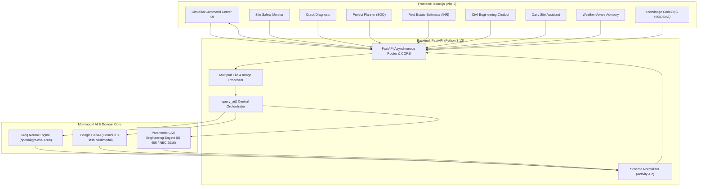

# ConstructAI — Multimodal Construction Intelligence Platform

<p align="center">
  
  
  
  
  
  
</p>

---

## 📌 Executive Summary

**ConstructAI** is an intelligent, full-stack decision-support system designed to assist construction project managers, structural civil engineers, safety compliance officers, and real estate valuation estimators across all phases of modern capital construction.

By fusing **multimodal artificial intelligence** (processing site imagery, structural crack close-ups, and textual observations) with **deterministic civil engineering rules** (adhering strictly to **IS 456:2000**, **NBC 2016**, and **OSHA 1926**), ConstructAI automates safety compliance auditing, failure risk mitigation, Bill of Quantities (BOQ) estimation, and weather-critical operational planning.

> **Program:** Generative AI with Google Cloud Virtual Internship  
> **Platform:** SmartInternz / MySkillWallet  
> **Author:** Mahak Khatri  

---

## 🏛️ System Architecture

ConstructAI implements a decoupled client-server architecture with strict JSON schema enforcement to ensure zero runtime crashes and enterprise-grade reliability.



---

## ⚡ Core Feature Modules

### 1. 🛡️ Site Safety Monitor (`/api/safety-monitor`)
* **Multimodal Inspection:** Ingests raw site observation text and high-resolution site photography.
* **Threat Index Scoring:** Categorizes hazards into *High Risk*, *Moderate Risk*, or *Low Risk*.
* **PPE Compliance Verifier:** Detects hard hats, high-vis reflective vests, and safety boots while flagging missing PPE (fall arrest harnesses, goggles, protective gloves).
* **OSHA Standard Mapping:** Automatically references **OSHA 1926.451** (Scaffolding), **OSHA 1926.501** (Fall Protection), and **IS 4014**.
* **Corrective Directives:** Issues prioritized, actionable site instructions for supervisors.

### 2. 🔍 Structural Crack Diagnosis (`/api/crack-detection`)
* **Computer Vision Reasoning:** Analyzes crack geometry, orientation (diagonal, horizontal, vertical), and location on structural members (beams, columns, slabs).
* **Failure Classification:** Distinguishes between diagonal shear stress cracks, plastic shrinkage fissures, and foundation settlement fractures.
* **Engineering Remediation:** Specifies precise repair protocols including ASTM C881 low-viscosity epoxy pressure injection, CFRP carbon wraps, and tell-tale monitoring plates.

### 3. 🏢 Real Estate Estimator (`/api/real-estate-valuation`)
* **Indian Market Intelligence:** Dynamically evaluates market values for metro and tier-2 locations across India (e.g., *Indore, Rau, Silicon City, Bengaluru, Mumbai, Pune, NCR*).
* **Parametric Valuation:** Adjusts rates per sq.ft based on building lifecycle depreciation, property category (Residential, Commercial, Industrial), and specified amenities.
* **Investor Metrics:** Computes estimated market valuation in **₹ INR (Lakhs / Crores)**, price per sq.ft, gross rental yield (%), and monthly rental potential.

### 4. 📋 Construction Project Planner (`/api/project-planner`)
* **Automated BOQ:** Converts scope briefs (e.g., *"20x50 ft G+1 duplex villa"*) into a detailed Bill of Quantities.
* **Material Estimator:** Accurately computes cement bags (OPC/PPC), river/M-sand (cu.ft), 20mm aggregate, TMT high-yield rebar (Fe550D tonnage), and concrete volume (m³).
* **Cost & Milestone Schedule:** Generates categorized cost breakdowns (Materials, Labour, Finishing, Contingency) and phase-wise week Gantt roadmaps.

### 5. 🤖 Construction Domain Chatbot (`/api/chatbot`)
* **Engineering Copilot:** Provides instant, context-aware answers to complex structural engineering, concrete technology, and building code queries.
* **Dynamic Action Chips:** Generates one-click quick suggestion prompts for standard compliance guidelines.

### 6. 📅 Daily Site Assistant (`/api/site-assistant`)
* **Shift Optimization:** Organizes workforce headcounts across specialized activity cells (concreting, shuttering, rebar fabrication).
* **Shift Safety Checks:** Delivers mandatory pre-shift PPE checklists and equipment ELCB/RCCB electrical checks.
* **Risk Warnings:** Alerts foremen to critical hazards such as concrete cold joint delays or worker heat exhaustion.

### 7. 🌦️ Weather-Aware Advisory (`/api/weather-advisor`)
* **Meteorological Simulation:** Evaluates current/forecast weather against weather-sensitive operations (concrete slab casting, high crane hoisting, deep excavation).
* **Decision Engine:** Delivers unambiguous **GO / NO-GO / PROCEED WITH CAUTION** verdicts with specific hazard alerts and waterproofing contingency steps.

### 8. 📚 Construction Knowledge Assistant (`/api/knowledge-assistant`)
* **Centralized Engineering Codex:** Searchable repository categorized into **Safety**, **Technique**, and **Document Generation**.
* **Codes Covered:** Bureau of Indian Standards (**IS 456:2000**, **SP 34**), **NBC 2016**, and **OSHA 1926**.

---

## 🎯 MySkillWallet Milestone & Epic Mapping

| Milestone / Epic | Implemented Activities | Code Reference |
| :--- | :--- | :--- |
| **Epic 1: Requirements & Setup** | Functional requirements definition & dependency management | `backend/requirements.txt`, `src/App.jsx` |
| **Epic 2: Image-Based Analysis** | Multimodal safety image auditing & structural crack diagnostics | `SafetyMonitor.jsx`, `CrackDetection.jsx` |
| **Epic 3: Planning & Valuation** | Parametric BOQ material calculator & Indian ₹ market valuation | `ProjectPlanner.jsx`, `Valuation.jsx` |
| **Epic 4: AI Intelligence Layer** | Central LLM orchestrator & JSON schema contract normalization | `backend/main.py` (`query_ai()`, `normalize_output()`) |
| **Epic 5: Assistant & Advisory** | Construction chatbot, daily shift coordinator & weather engine | `ConstructionChatbot.jsx`, `DailySiteAssistant.jsx`, `WeatherAdvisor.jsx` |
| **Epic 6: Testing & Deployment** | End-to-end integration, UI stability & edge-case validation | `run_dev.bat`, `test_groq_json.py` |

---

## 🛠️ Technology Stack

| Layer | Component | Specification |
| :--- | :--- | :--- |
| **Frontend Framework** | React.js 18.3 | Vite 5 build tool, modern ES6+ modules |
| **UI & Styling** | Custom CSS3 System | Obsidian Dark theme (`#090D16`), Construction Neon Orange (`#FF7600`), Glassmorphism |
| **Icons & Animation** | Lucide React & Framer Motion | Smooth state transitions, interactive dropzones, badges |
| **HTTP Client** | Axios 1.7 | Strict JSON schema handling, multipart form payloads |
| **Backend Framework** | FastAPI 0.110 | Asynchronous ASGI server on Python 3.13, Pydantic v2 schemas |
| **AI Reasoning Layer** | Groq SDK & Google GenAI | `openai/gpt-oss-120b` (120B parameter model), `gemini-3.8-flash` |
| **Fallback Engine** | Dynamic Heuristics | Zero-downtime civil engineering calculation algorithms |

---

## 🔌 API Reference & Endpoints

| Endpoint | Method | Input Parameters | Output Contract (JSON) |
| :--- | :---: | :--- | :--- |
| `/api/safety-monitor` | `POST` | `text` (Form), `image` (Multipart File, opt), `document` (opt) | `hazards`, `risk_level`, `ppe`, `missing_ppe`, `osha_standards`, `corrective_actions` |
| `/api/crack-detection` | `POST` | `text` (Form), `image` (Multipart File, opt) | `crack_type`, `severity`, `probable_causes`, `potential_risks`, `repair_methods` |
| `/api/real-estate-valuation` | `POST` | `location`, `area`, `property_type`, `building_age`, `amenities` | `location`, `estimated_market_value`, `price_per_sqft`, `rental_yield`, `monthly_rental_potential`, `factors` |
| `/api/project-planner` | `POST` | `desc` (JSON or Form) | `project_summary`, `materials` (BOQ), `cost_breakdown` (₹), `schedule` (Gantt) |
| `/api/chatbot` | `POST` | `{"query": "..."}` | `reply`, `action_suggestions` |
| `/api/site-assistant` | `POST` | `{"activity", "labour_count", "site_condition"}` | `tasks`, `safety_checks`, `risk_alerts` |
| `/api/weather-advisor` | `POST` | `{"activity", "weather"}` | `recommendation`, `status_code`, `reasoning`, `hazards`, `precautions` |
| `/api/knowledge-assistant` | `POST` | `{"category", "query"}` | `category`, `title`, `guidelines`, `regulatory_codes`, `sample_document` |

---

## 🚀 Quick Setup & Installation Guide

### Prerequisites
* **Python 3.9+** (Python 3.13 verified)
* **Node.js 18+ & npm** (Node v24 verified)

### 1. Clone the Repository
```bash
git clone https://github.com/<YOUR-USERNAME>/construct-ai.git
cd construct-ai
```

### 2. Environment Configuration
Create a `.env` file in the `backend/` directory:
```env
# Optional: Add Groq API Key for live 120B LLM reasoning (from console.groq.com)
GROQ_API_KEY=gsk_your_groq_api_key_here

# Optional: Add Google Gemini API Key (from aistudio.google.com)
GEMINI_API_KEY=your_gemini_api_key_here

PORT=8000
```

### 3. One-Click Launcher (Windows)
Simply double-click the **`run_dev.bat`** file in the root folder. It automatically boots both the FastAPI backend and Vite frontend and opens your browser.

### 4. Or Run Manually:

#### Terminal 1 — Backend:
```powershell
cd backend
pip install -r requirements.txt
python -m uvicorn main:app --reload --port 8000
```
* Interactive Swagger API Docs: `http://localhost:8000/docs`

#### Terminal 2 — Frontend:
```powershell
cd frontend
npm install
npm run dev
```
* Interactive Command Center UI: `http://localhost:5173`

---

## 💻 Hardware & Software Requirements

* **Processor:** Intel Core i5 (8th Gen or above) / AMD Ryzen 5 or equivalent
* **RAM:** Minimum 8 GB (16 GB recommended for multi-tasking and vision model pipelines)
* **Storage:** 256 GB SSD minimum
* **Operating System:** Windows 10/11, macOS (Monterey+), or Ubuntu Linux 20.04+
* **Browser:** Latest version of Google Chrome, Edge, or Mozilla Firefox

---

## 📜 License & Acknowledgments

This project is open-source under the [MIT License](LICENSE).  
Developed as part of the **Google Cloud & SmartInternz Generative AI Virtual Internship**. Special thanks to Google Cloud learning paths, Vertex AI documentation, and SmartBridge mentors.
